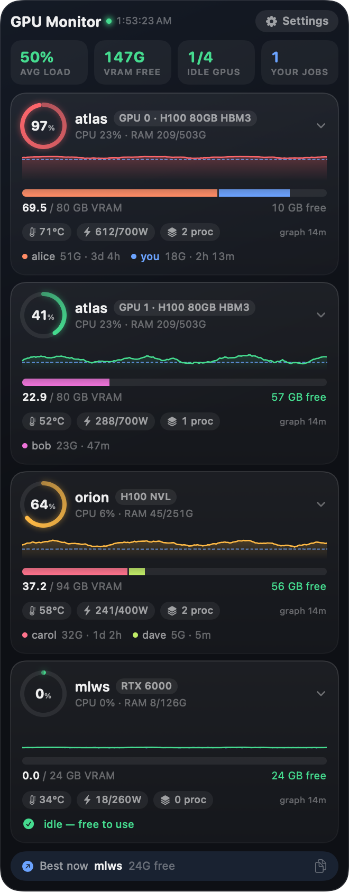

<p align="center"></p>

<h1 align="center">GPU Monitor</h1>

<p align="center">A tiny macOS desktop widget showing every GPU on your SSH servers:<br>load, VRAM, and who's using it.</p>

<p align="center"></p>

No agents to install on the servers. It runs `nvidia-smi` over the SSH keys you already have, every 5 seconds.

- **Cluster at a glance**: average load, free VRAM, idle GPUs, and how many jobs you're running.
- **A card per GPU**: a load ring, a 15-minute load/VRAM graph, a VRAM bar split by user, temperature, power, and the server's CPU and RAM.
- **Who's on it**: each user's VRAM and how long they've been running. Your jobs are shown in blue. Click a card to see every process with its command.
- **Best now**: the GPU with the most free VRAM. Click it to copy an `ssh … CUDA_VISIBLE_DEVICES=N` command.
- **Settings** button (top right): add or remove servers, choose where the widget lives (desktop / window / on top), and set its height. No config files.
- **Scrolls**: the header and stats stay put while the GPU cards scroll, and the height always fits your screen.
- There's also a full web dashboard with history graphs at <http://localhost:8765>.

## Install

Requirements:
- macOS 14+
- Xcode command line tools (`xcode-select --install`)
- Python 3 (standard library only)
- Passwordless SSH to each server: `ssh user@host` must work without a prompt.

```bash
git clone https://github.com/Kyk0/gpumon.git
cd gpumon
./install.sh
```

This puts **GPU Monitor** in `/Applications` and starts it at login. Drag the widget anywhere; it remembers its position.
Click **Settings** and add a server with a name and an ssh target (`user@host` or an alias from `~/.ssh/config`).

Servers are saved in `hosts.json` (git-ignored; see `hosts.example.json`).

## Update / uninstall

```bash
git pull && ./install.sh   # rebuild and restart
./uninstall.sh             # remove app + login items (keeps hosts.json)
```

Logs: `/tmp/local.gpumon.*.log`.

## How it works

`gpumon.py` is a small stdlib-only Python service. It keeps one multiplexed SSH connection per server (`ControlMaster`). Every 5 seconds it runs `nvidia-smi` plus `ps` to map each process to its user, and serves the results as JSON on `127.0.0.1:8765`. The SwiftUI app (`GPUMonitor.swift`, compiled with `swiftc`, no Xcode project needed) reads that JSON and draws the widget.
